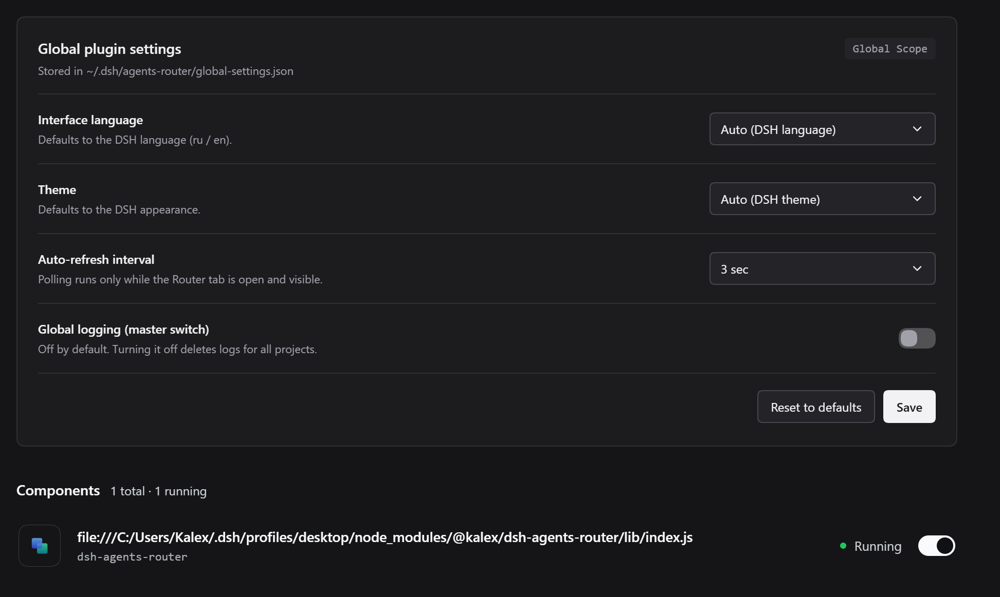
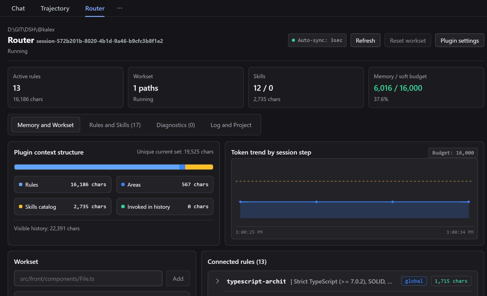

# Примеры в DSH

## Настройки плагина

Описание плагина и его настройки открываются на странице «Плагины» в DeepSeek Harness.



_Настройки плагина на странице «Плагины» (блок ниже описания)._

## Панель роутера в сессии

В окне сессии плагин показывает, какие правила и навыки подгружены в контекст, а также бюджет токенов.



_Панель маршрутизатора в окне сессии: подгруженные правила и навыки, бюджет токенов._

## Каталог проекта

Плагин приводит инструкции проекта к единой структуре `agents/` с зонами ответственности:

```text
agents/
├─ rules/      глобальные правила
├─ skills/     глобальные навыки
├─ agents.md   главный файл правил
├─ front/
│  ├─ rules/   правила фронта
│  └─ skills/  навыки фронта
├─ back/
│  ├─ rules/   правила бэка
│  └─ skills/  навыки бэка
└─ openspec/
   ├─ rules/   правила спеков
   └─ skills/  навыки спеков
```

_Единая структура инструкций проекта с зонами ответственности._

## Память и метрики

Вкладка «Память» показывает метрики контекста: сколько токенов занимают правила и навыки, бюджет и графики.


_Метрики контекста во вкладке «Память»._
