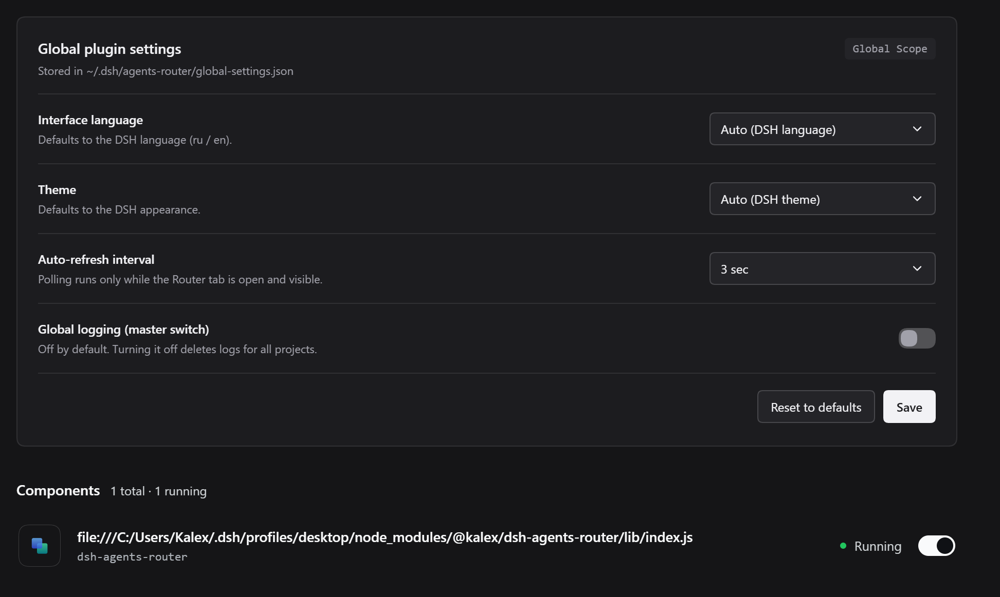
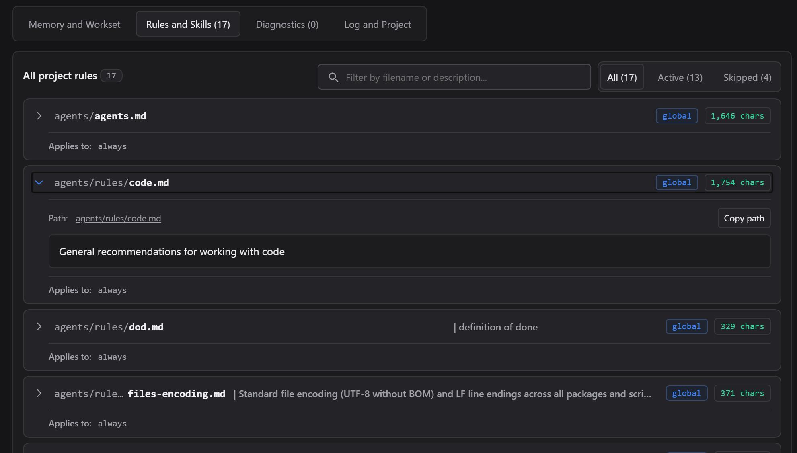
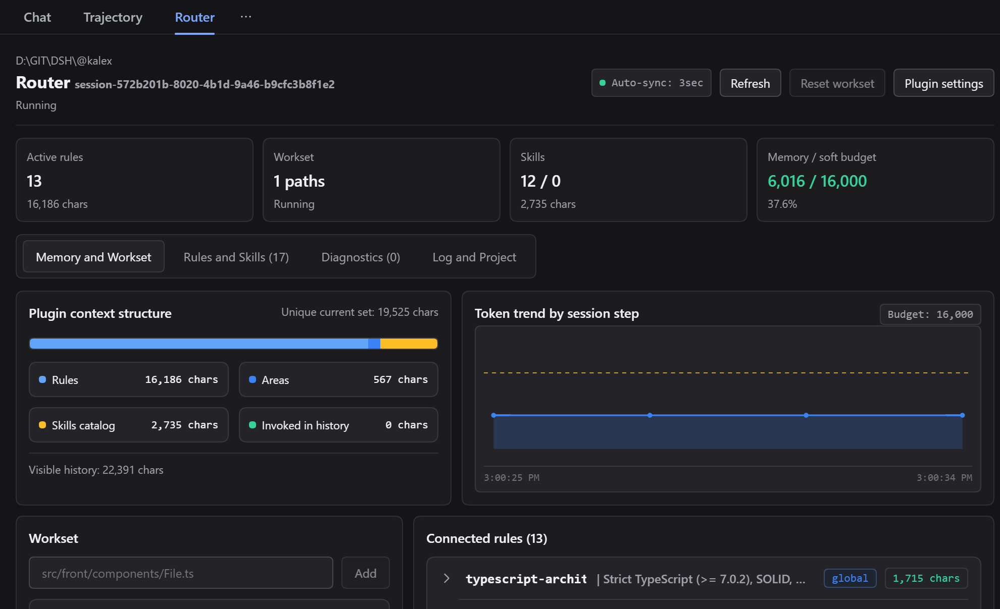

# Примеры в DSH

## Настройки плагина

На странице **Плагины** выберите **Маршрутизатор инструкций агента**. Настройки находятся под описанием.

## Активные правила в сессии

Откройте **Маршрутизатор** и выберите **Активные правила**, чтобы увидеть инструкции для текущего рабочего набора.

## Инструкции проекта

Откройте [демопроект](../examples/demo-project/README.md) как рабочий каталог DSH. Проверьте, как правила меняются при добавлении файлов из разных зон в рабочий набор.

## Оценка токенов

Вкладка **Память и Workset** показывает оценку числа токенов инструкций и отмечает превышение бюджета.

