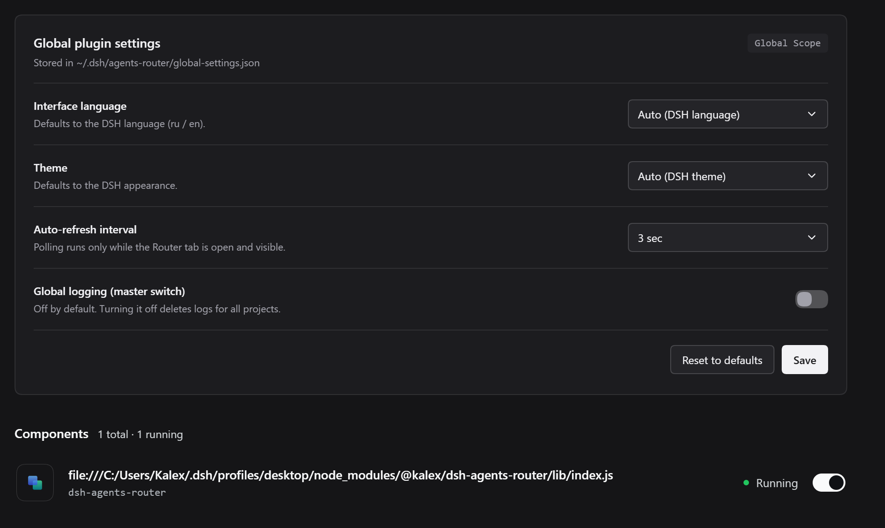
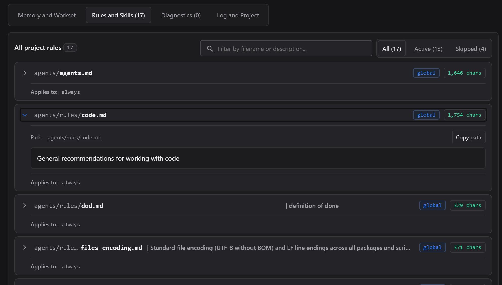
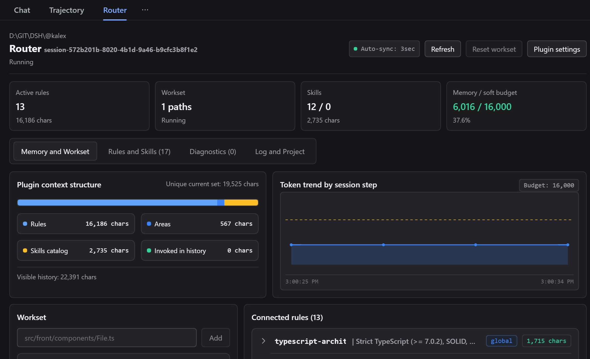

# Examples in DSH

## Plugin settings

On the **Plugins** page, select **Agent Instructions Router**. The settings are below the description.

## Active rules in a session

Open **Router** and select **Active Rules** to see the instructions for the current workset.

## Project instructions

Open the [demo project](../examples/demo-project/README.md) as a DSH working directory. Add files from different areas to the workset to see how the active rules change.

## Token estimates

The **Memory and Workset** tab shows the estimated instruction token count and indicates when it exceeds the budget.

