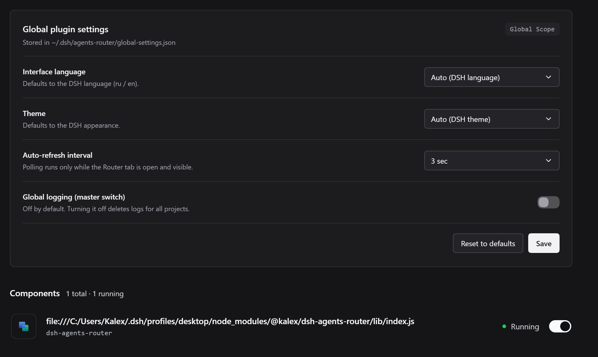
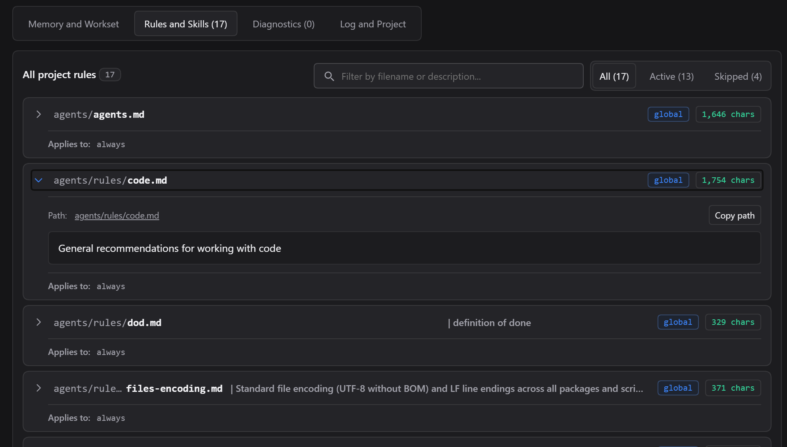
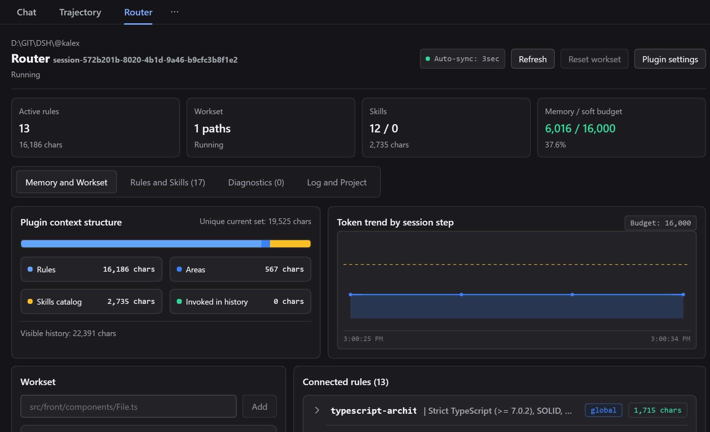

# Examples in DSH

## Plugin settings

The plugin description and its settings open on the "Plugins" page in DeepSeek Harness.



_Plugin settings on the "Plugins" page (the block below the description)._

## Router panel in a session

In a session window, the plugin shows which rules and skills are loaded into the context, plus the token budget.



_Router panel in a session window: loaded rules and skills, token budget._

## Project catalog

The plugin brings project instructions into a single `agents/` structure with responsibility areas:

```text
agents/
├─ rules/      global rules
├─ skills/     global skills
├─ agents.md   main rules file
├─ front/
│  ├─ rules/   front-end rules
│  └─ skills/  front-end skills
├─ back/
│  ├─ rules/   back-end rules
│  └─ skills/  back-end skills
└─ openspec/
   ├─ rules/   OpenSpec rules
   └─ skills/  OpenSpec skills
```

_Single project instruction structure with responsibility areas._

## Memory and metrics

The "Memory" tab shows context metrics: how many tokens rules and skills take, the budget, and charts.



_Context metrics in the "Memory" tab._
