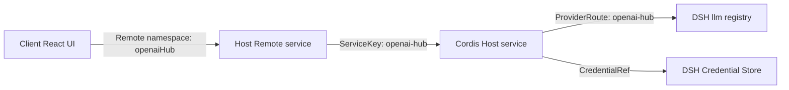
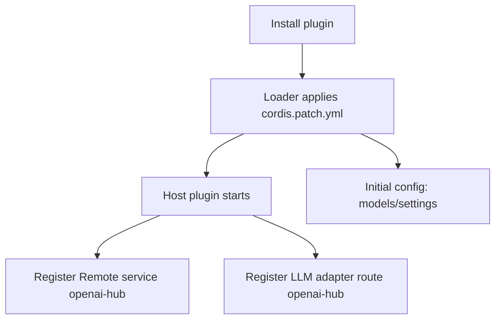
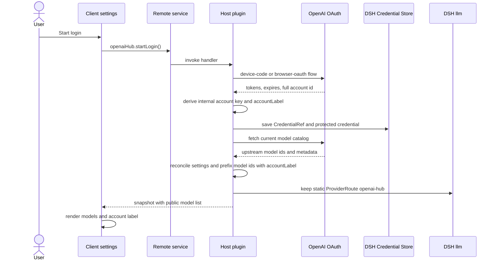
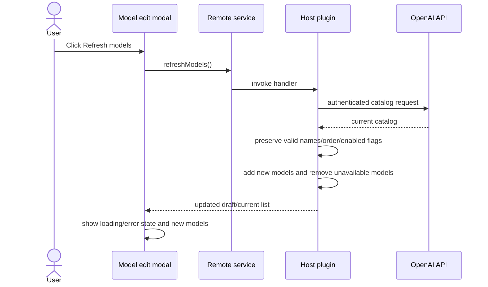
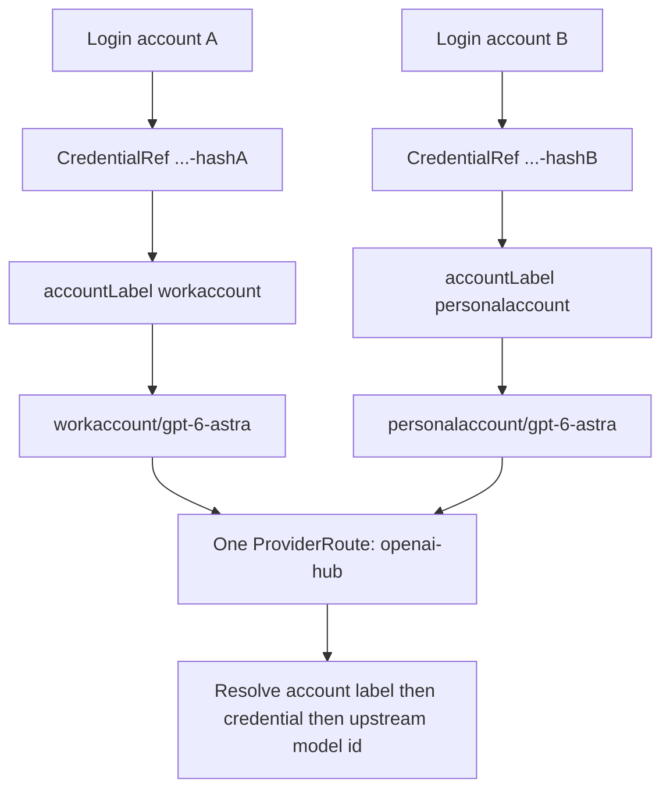

# OpenAI Hub workflow

This document describes the planned stable naming and runtime flow for the plugin.

## Naming

- Package target: `@kalex/dsh-openai-hub`. Package and directory rename is the first implementation stage, before route, model catalog, and modal fixes.
- The legacy package is not supported or automatically migrated. Users remove the old plugin and install the new package manually. All documentation, references, and configuration examples must use the new package name.
- Local project base: `openai-codex-provider`.
- `ServiceKey`: `openai-hub`. This is the global Cordis Host service key used by the generated Remote contract. It is not an LLM provider route.
- `ProviderRoute`: `openai-hub`. This is the LLM route passed to `llm.registerAdapter` and used in model requests. It must be unique in the DSH LLM registry.
- `AuthMethod`: `device-code` or `browser-oauth`.
- `CredentialRef`: `openai-hub-<authMethod>-<8-hex-hash(accountId)>`. The internal key is derived from a hash of the full OpenAI account id and is not displayed.
- `accountLabel`: always the public model namespace. By default it is the last eight digits of the account id. The user sets it in a dedicated account/auth field before OAuth and can edit it later in the account card. Labels are lowercase ASCII slugs only: lowercase Latin letters, digits, and hyphens, with no spaces, using DSH's default identifier conventions.
- Provider group name: `OpenAI Hub`.
- Public model id and chat model name: `<accountLabel>/<upstreamModelId>`, for example `12345678/gpt-6-astra` or `workaccount/gpt-6.2-sol`.
- Subagent presentation may add the DSH provider prefix: `openai-hub/<accountLabel>/<upstreamModelId>`. The plugin does not store that prefix in the model name.

The full account id is retained only inside the protected credential record. It is never logged, placed in `cordis.patch.yml`, or exposed as a public model id. Account labels and model settings are persisted in the plugin configuration through `configEditor`; secrets remain in Credential Store. A label change does not move the credential record. Renaming a label rebuilds that account's public model IDs and persists settings; old conversation history references are not rewritten. Old history references are marked stale and require manual selection of a current model; aliases are not retained.

## Keys and scopes



`ServiceKey` is a Cordis context service name. It is globally resolved within the relevant context, so another plugin must not reuse it. The service is not private by name alone; consumers need the contract and access to the context.

`ProviderRoute` is a global LLM adapter route. It selects the adapter for streaming and model metadata. It is also used in the request header together with the public model id.

`CredentialRef` identifies one protected credential record. It is not written to the profile patch and must not contain access or refresh token values.

## Installation and profile configuration



The package patch only mounts the plugin. It is not rewritten by OAuth and does not become a token store. When the plugin persists user settings through `configEditor`, DSH may update the active profile's composed configuration row, for example:

The configuration is account-oriented and future-ready:

```yaml
config:
  accounts:
    - accountLabel: workaccount
      authMethod: device-code
      credentialKey: 7f3a91c2
      models:
        - id: gpt-6-astra
          name: GPT-6 Astra
          enabled: true
```

The single `ProviderRoute` remains `openai-hub`; account-local model settings are projected into one combined DSH model list, with public ids such as `workaccount/gpt-6-astra` and `personalaccount/gpt-6.2-sol`.

```yaml
- id: dsh-openai-codex-provider
  name: "@kalex/dsh-openai-codex-provider"
  config:
    modelSettings:
      - id: 12345678/gpt-6-astra
        name: GPT-6 Astra
        enabled: true
```

The exact row id and package name will change during the package rename migration. `cordis.patch.yml` remains unchanged unless a separate, verified configuration migration requires it.

## First account flow



For a request:

The chat status bar shows usage only for this provider and the account/model currently selected. It shows the applicable percentage or remaining amount, the nearest reset, and credits when available. It is hidden for other providers.

```text
provider = openai-hub
model    = 12345678/gpt-6.2-sol
```

The adapter resolves `12345678` to the protected credential, strips the public prefix, and sends `gpt-6.2-sol` to the upstream API.

## Account blocks and quota refresh

The DSH Settings -> Models surface renders one account information block per configured account, in sequence. Each block owns its own account model modal. The page does not refresh quotas for every account when it opens. Each block has an auto-refresh-limits switch disabled by default for new accounts. The switch is persisted per account through `configEditor`. When enabled, that account normally refreshes every 5 minutes. For the account/model selected in the chat, if the applicable remaining limit is below 25%, its refresh interval becomes 1 minute. If multiple limits exist, use the nearest reset window as the priority: hourly, then 5-hour, then daily, and so on. Opening an account's model modal triggers the existing automatic refresh for that account only. Background refresh must pause network requests while the DSH page is hidden and perform one refresh when it becomes visible again, using the browser visibility API if no supported DSH visibility service exists.

## Model refresh in the edit modal



The refresh path must preserve user settings for unchanged upstream ids, include newly available models such as Sol 6.2 and Astra 6.2, and not expose credentials in errors or logs. The authenticated API catalog is authoritative; if it is temporarily unavailable, keep the last successful catalog and show the refresh error. If no successful API catalog exists yet, show the local `pi-ai.getModels()` fallback catalog.

## Second account, future-ready shape



The current implementation may keep one active credential while the resolver boundary is introduced. Adding a second account later should add another credential record and account-scoped model entries, not another provider route or another Cordis patch row. Deleting an account removes all plugin-owned account data from Credential Store and plugin configuration/settings, removes its models from the catalog, and leaves history/messages unchanged with stale model references. Deleting the last account resets the plugin to the fresh-install state: no accounts, no account settings or stored models, and the initial add-account UI.

## Safety and migration rules

- Never use the bare route `openai-codex`; it can collide with DSH's standard provider.
- Do not put token values, full account ids, or credential contents in logs, model ids, or `cordis.patch.yml`.
- Keep the provider route static; account selection belongs in the model namespace and credential resolver.
- Keep `ServiceKey`, `ProviderRoute`, `CredentialRef`, and `RemoteNamespace` distinct in code even when their textual prefixes match.
- Validate public labels and reject duplicates explicitly. A duplicate default label requires a user-provided label.
- Package renaming, generated `lib` rebuilds, and profile migration must be handled as a separate controlled step.
