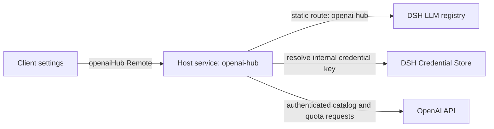

# OpenAI Hub workflow

This document describes the multi-account OpenAI Hub runtime and its operational constraints.

## Names and identifiers

- Installable package: `@kalex/dsh-openai-hub`.
- Remote service key: `openai-hub`; Remote namespace: `openaiHub`.
- The plugin registers one static LLM provider route: `openai-hub`. Account login, removal, and label changes do not create or replace routes.
- Provider group: `OpenAI Hub`.
- Each account has a unique label of 1 to 32 characters. Start with a lowercase ASCII letter, then use lowercase ASCII letters, digits, or hyphens. Enter the label before OAuth; it can be edited on the account card.
- Public model ID and model name: `<accountLabel>/<upstreamModelId>`, e.g. `workaccount/gpt-6.2-sol`. An external DSH subagent presentation may prepend `openai-hub/`; this is not part of the plugin model name.
- Credential Store references use the SDK-compatible internal form `openai_hub_device_code_<8-hex-hash>` or `openai_hub_browser_oauth_<8-hex-hash>`. The OpenSpec logical reference is `openai-hub-<authMethod>-<8-hex-hash(accountId)>`; the underscore spelling is an internal adapter key required by the SDK validator. Neither form contains tokens. Full account IDs and secrets stay in the protected Credential Store record and are not exposed in configuration, model IDs, snapshots, logs, errors, or UI.

## Storage and request flow

Account configuration contains account labels, auth method, credential reference metadata, per-account model settings, and the per-account quota auto-refresh preference. New accounts have auto-refresh disabled. OAuth tokens and full account identifiers are stored only in DSH Credential Store.

Before OAuth, the user supplies an account label. On successful authorization the host stores credentials in Credential Store, persists only non-secret account configuration, loads the authenticated model catalog, and combines the account's models into the single route. For a chat request, the adapter resolves the account from the public model namespace, retrieves its protected credential, and sends the original upstream model ID.

Changing a label rebuilds that account's public model IDs without moving its credential record. Existing conversation history is not rewritten; references to old IDs are stale and require selecting a current model. Removing an account clears only its owned credentials, settings, and models; history remains untouched. Removing the last account returns the plugin to the initial add-account state with no residual account configuration or client cache.

## Catalog and fallback behavior

The authenticated API catalog loads after login and on explicit Refresh. Models from all accounts appear under provider group `OpenAI Hub` as `<accountLabel>/<upstreamModelId>`. Reconciliation preserves names, order, and enabled state for still-available models, adds new API models, and removes unavailable ones. Requests unwrap the label namespace and use the upstream ID.

The API catalog is authoritative. If a refresh fails after a successful fetch, the last successful catalog remains usable and the UI reports the refresh error. Before the first successful API catalog, the local `pi-ai.getModels()` catalog is used and the refresh failure is reported. Do not interpret missing quota/catalog fields as zero or expose raw credential-bearing errors.

## Per-account quota policy

Settings -> Models displays one information block and a dedicated model modal for each account. Each account has its own persisted automatic quota-refresh switch, off by default. Enabling it polls that account every five minutes. For the account/model selected in chat, use one-minute polling when its nearest applicable remaining quota is below 25%. When choosing the applicable window, prioritize hourly, then five-hour, then daily limits. Hidden pages issue no polling requests; returning to a visible page triggers one refresh for the relevant account. Manual refresh and opening an account's model modal concern that account only.

The chat status bar reads the SDK's per-session `modelDirectories.directoryFor(sessionId).store` selection, not timeline history or guessed slot fields. It shows the last known quota for the selected OpenAI Hub model and account. A plugin-lifetime subscription retains one polling timer per enabled account even with settings and composer unmounted. Settings and dock share that scheduler, preventing duplicate quota requests.

Toggling automatic refresh leaves the last known quota intact. Enabling it requests quota immediately only when no quota has been obtained yet. The host saves the last successful quota per account in the DSH profile and restores it on startup, even when automatic refresh is off. Failed or empty refreshes do not replace saved limits.

## Reinstall and acceptance

The package rename and account/configuration contract are not an in-place migration guarantee. Back up any needed profile settings, uninstall the legacy OpenAI Codex plugin, install `@kalex/dsh-openai-hub`, restart DSH if required, and sign in again. See the installation steps and manual checks in [Setup](Setup.md) or [Setup_EN](Setup_EN.md). Do not assume legacy credentials or configuration are migrated.

## Known limitations

- The plugin has one static route and does not provide proxy-mode selection or a plugin-owned proxy transport. Network routing is supplied by DSH.
- Catalog availability depends on the authenticated API; fallback is the bundled local catalog until the first successful API response.
- Unknown API models use the bundled Codex protocol metadata template; API context/output token limits override that template when supplied. Their persisted ID/context/output metadata survives Loader configuration remounts. Review upstream capability changes when upgrading pi-ai.
- Browser OAuth uses a local callback on port 1455. If the sign-in dialog asks for the callback URL, paste the full redirected URL only into that dialog. Device-code sign-in is an alternative for a remote or headless Host.
- Saving account settings uses the normal DSH Loader configuration lifecycle; an incomplete initial catalog resumes in the new Host instance after a remount.
- Real-account acceptance and visual checks in the running DSH page must be performed by the user when no connected inspection/browser client is available; automated checks use synthetic accounts and credentials.
- Old conversation model IDs are not rewritten on label change or account removal.
