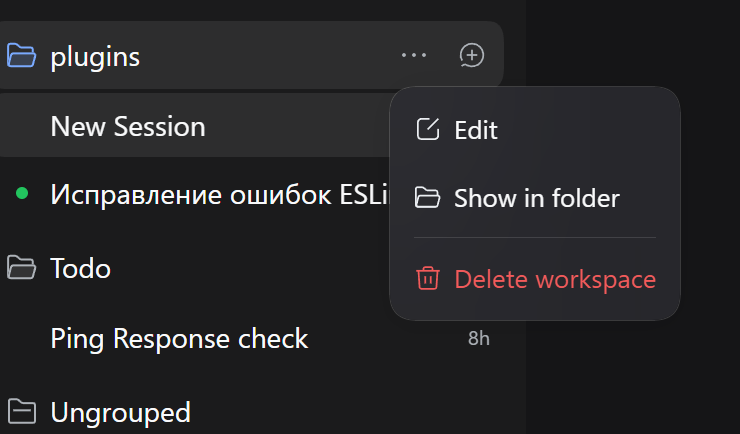
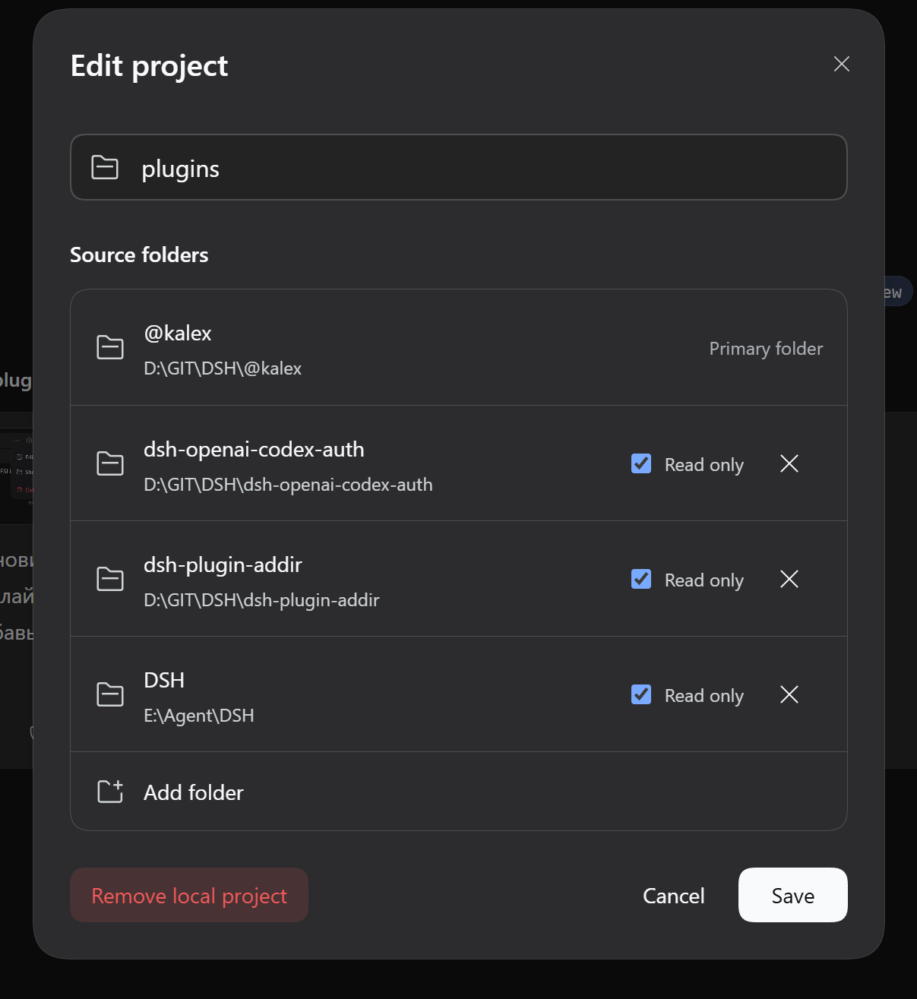

# [@kalex/dsh-workspace-manager](https://github.com/BlindGazer/DSH/tree/main/packages/dsh-workspace-manager)

> [GitHub BlindGazer/DSH](https://github.com/BlindGazer/DSH)

Плагин **DeepSeek Harness (DSH)** для подключения нескольких каталогов к рабочему пространству.
Форк [keatsyh/dsh-plugin-addir](https://github.com/keatsyh/dsh-plugin-addir).

## Интерфейс

Нажмите на `...` в боковом меню в области рабочей среды

Настройте окружение в модальном окне

## Назначение

Позволяет подключать каталоги из разных расположений, задавать им псевдонимы и описания, а также ограничивать доступ режимом только для чтения.

- [Команды и установка](https://github.com/BlindGazer/DSH/tree/main/packages/dsh-workspace-manager/doc/Setup.md) | [Commands and installation](https://github.com/BlindGazer/DSH/tree/main/packages/dsh-workspace-manager/doc/Setup_EN.md)
