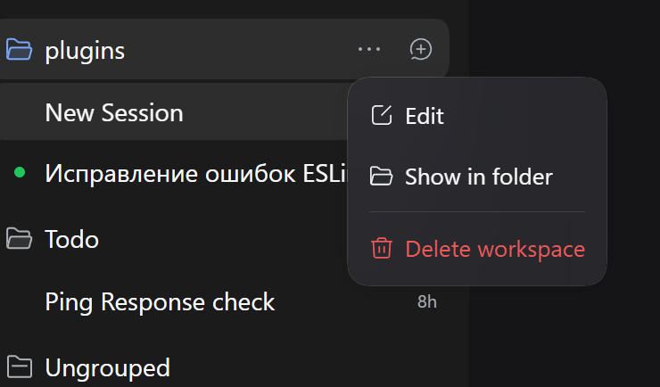
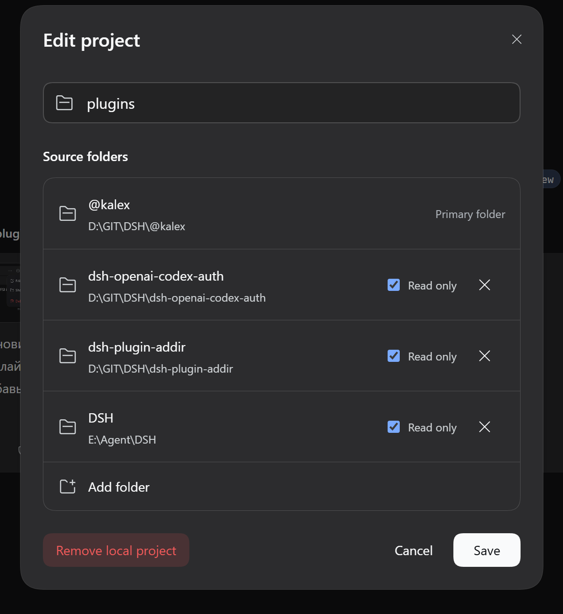

# Примеры в DSH

## Меню рабочего пространства

Кнопка `...` в боковом меню открывает меню действий рабочего пространства, где доступно управление подключенными каталогами.

_Меню действий рабочего пространства (кнопка `...` в боковом меню)._

## Редактор каталогов

В редакторе настраиваются подключенные каталоги: путь, псевдоним, описание и режим только для чтения.

## Сессия в отдельной ветке

В меню репозитория выберите **Новая сессия worktree**. Для отдельной задачи создайте новую ветку от нужной локальной ветки и откройте сессию в новом worktree. Незакоммиченные правки останутся в исходном каталоге. Чтобы удалить worktree после работы, используйте **Удалить worktree** в меню основной рабочей области.
