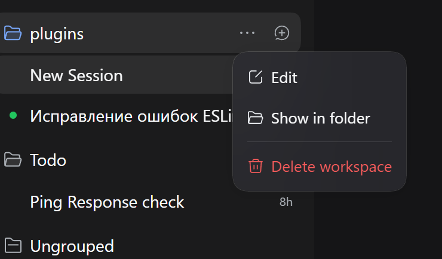
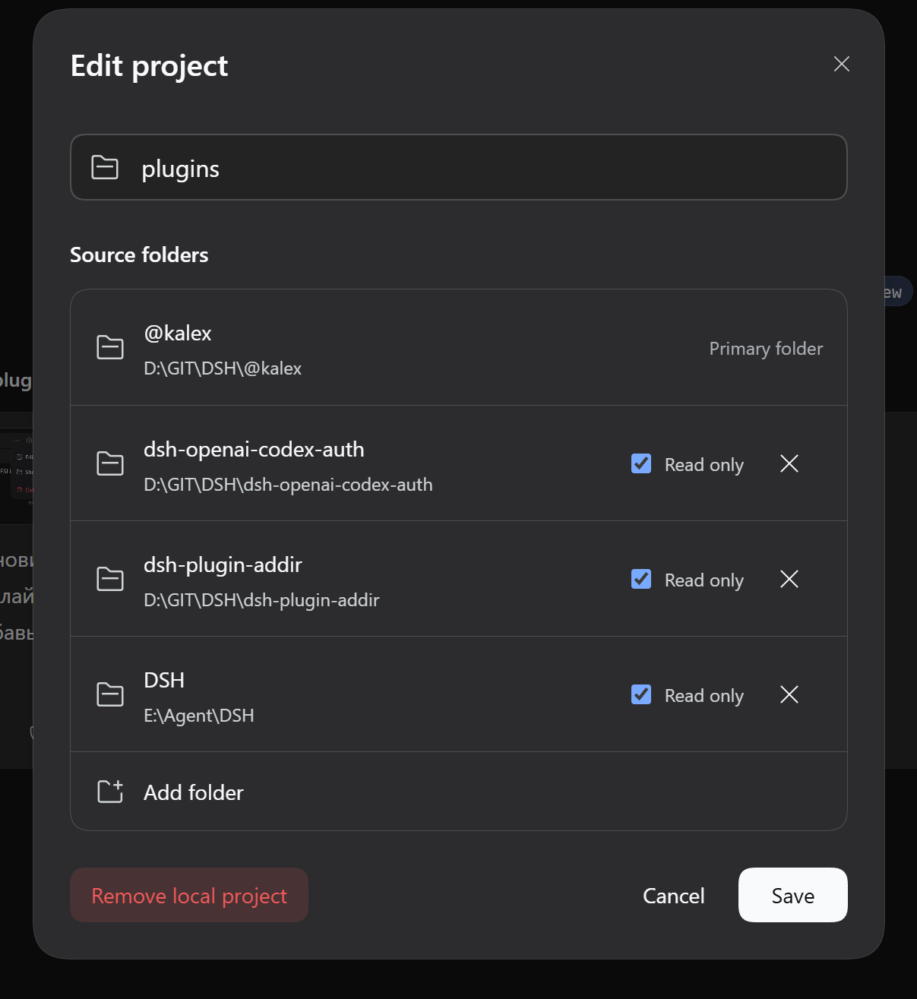

# Примеры в DSH

## Меню рабочего пространства

Кнопка `...` в боковом меню открывает меню действий рабочего пространства, где доступно управление подключенными каталогами.

_Меню действий рабочего пространства (кнопка `...` в боковом меню)._

## Редактор каталогов

В редакторе настраиваются подключенные каталоги: путь, псевдоним, описание и режим только для чтения.

_Редактор подключенных каталогов рабочего пространства._
