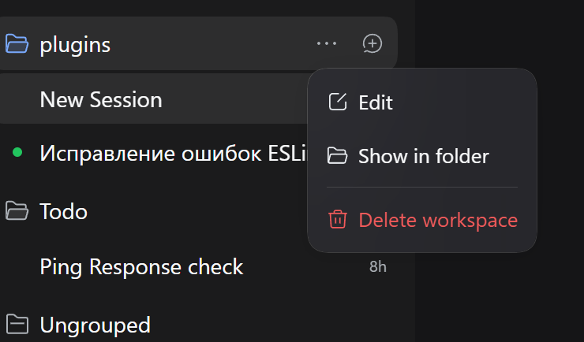
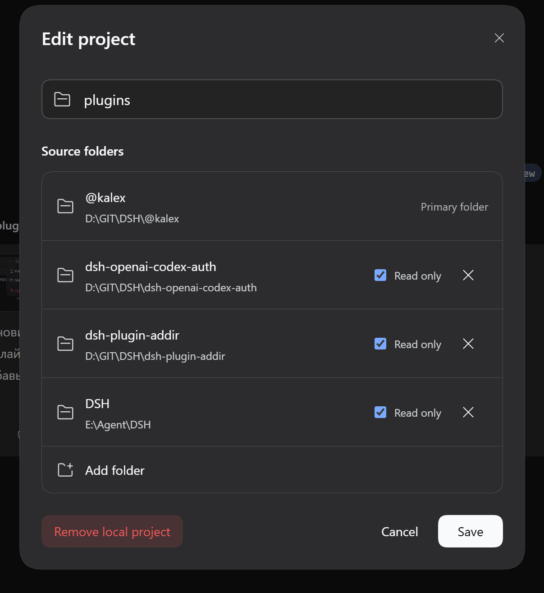

# Examples in DSH

## Workspace menu

The `...` button in the sidebar opens the workspace actions menu, where you can manage linked directories.

_Workspace actions menu (the `...` button in the sidebar)._

## Directory editor

In the editor you configure linked directories: path, alias, description, and read-only mode.

_Linked workspace directories editor._
