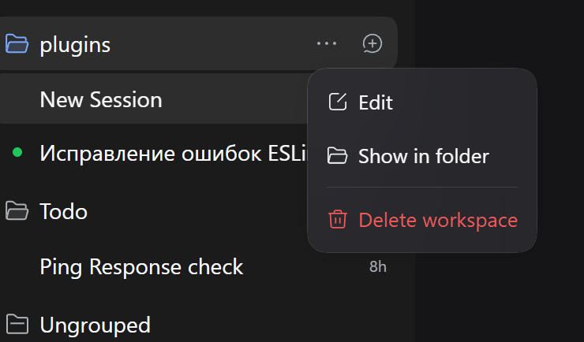
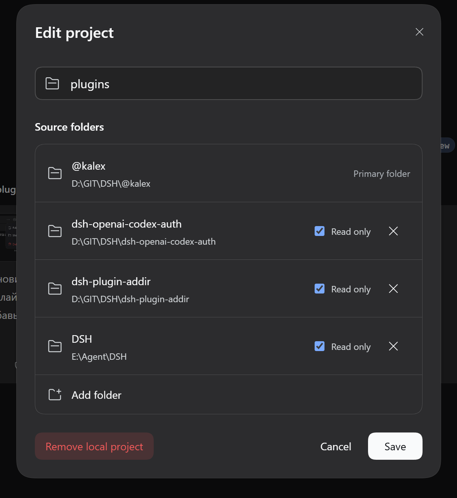

# Examples in DSH

## Workspace menu

The `...` button in the sidebar opens the workspace actions menu, where you can manage linked directories.

_Workspace actions menu (the `...` button in the sidebar)._

## Directory editor

In the editor you configure linked directories: path, alias, description, and read-only mode.

## Session on a separate branch

In the repository workspace menu, choose **New worktree session**. For a separate task, create a new branch from the local branch you want to start from and open a session in the new worktree. Uncommitted changes stay in the source checkout. When finished, use **Delete worktree** in the main workspace menu to remove the worktree.
