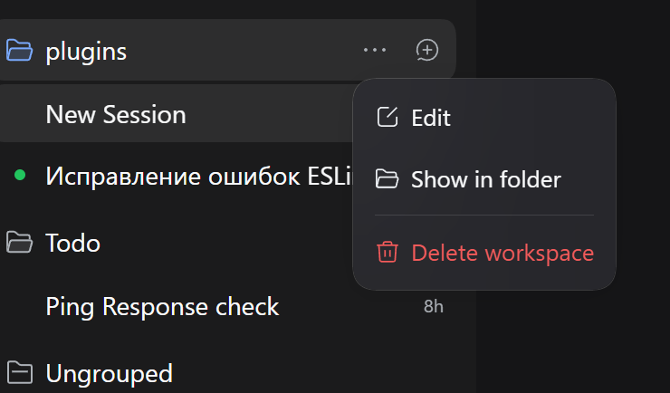
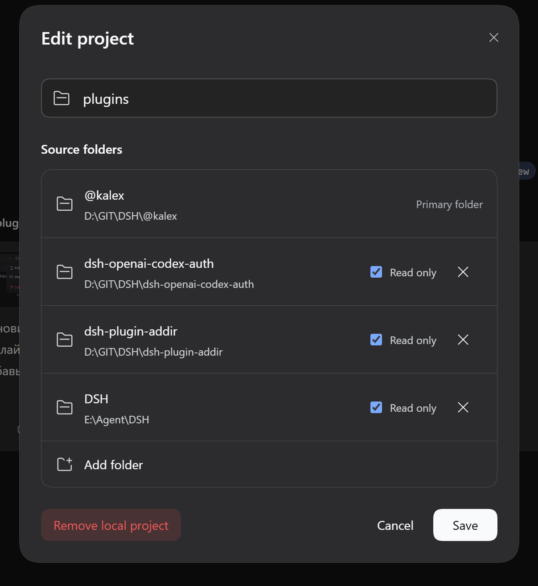

# [@kalex/dsh-workspace-manager](https://github.com/BlindGazer/DSH/tree/main/packages/dsh-workspace-manager)

> [GitHub BlindGazer/DSH](https://github.com/BlindGazer/DSH)

A plugin for **DeepSeek Harness (DSH)** that links multiple directories to a workspace.

Forked from [keatsyh/dsh-plugin-addir](https://github.com/keatsyh/dsh-plugin-addir).

## Interface

Open the workspace menu from the `...` button in the sidebar.

Configure linked directories in the editor dialog.

## Purpose

Link folders from different locations, give them aliases and descriptions, and optionally restrict access to read-only.

- [Commands and installation](https://github.com/BlindGazer/DSH/tree/main/packages/dsh-workspace-manager/docs/Setup_EN.md)
